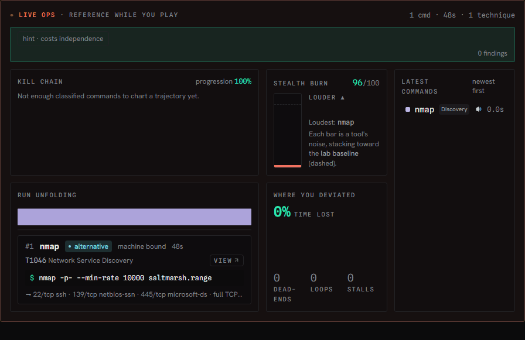
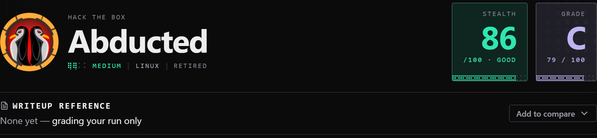
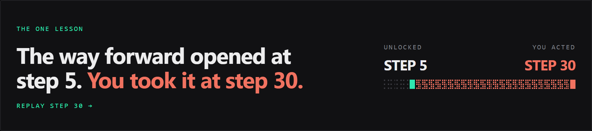
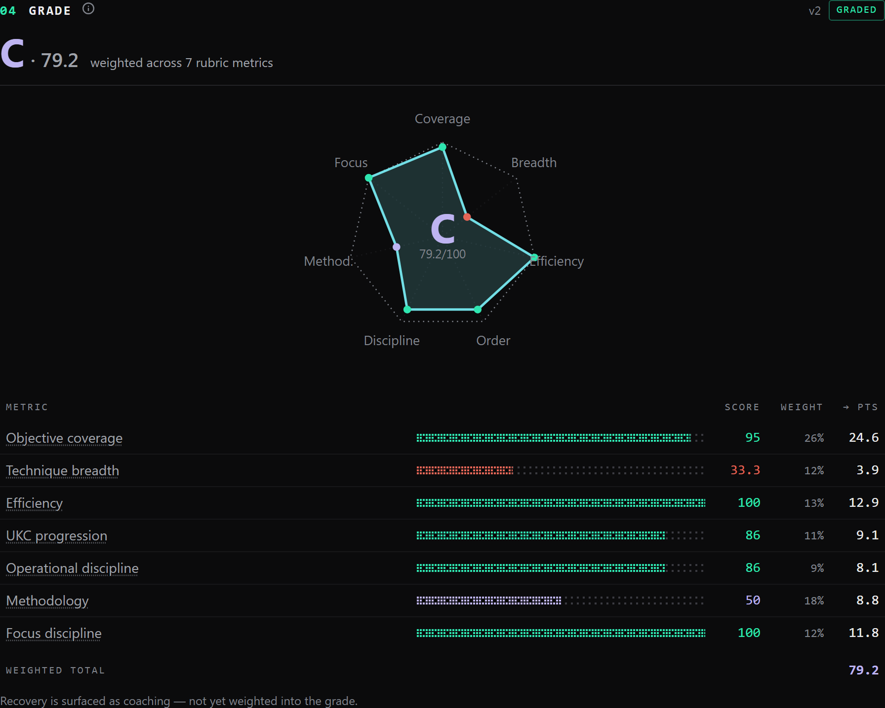
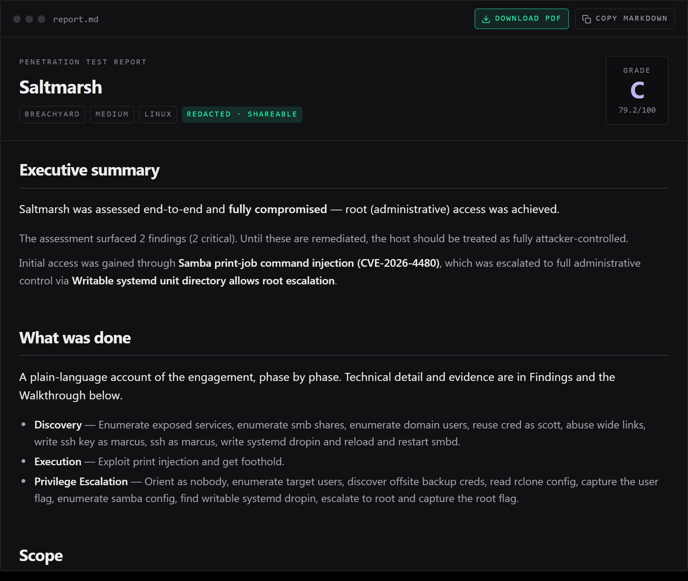
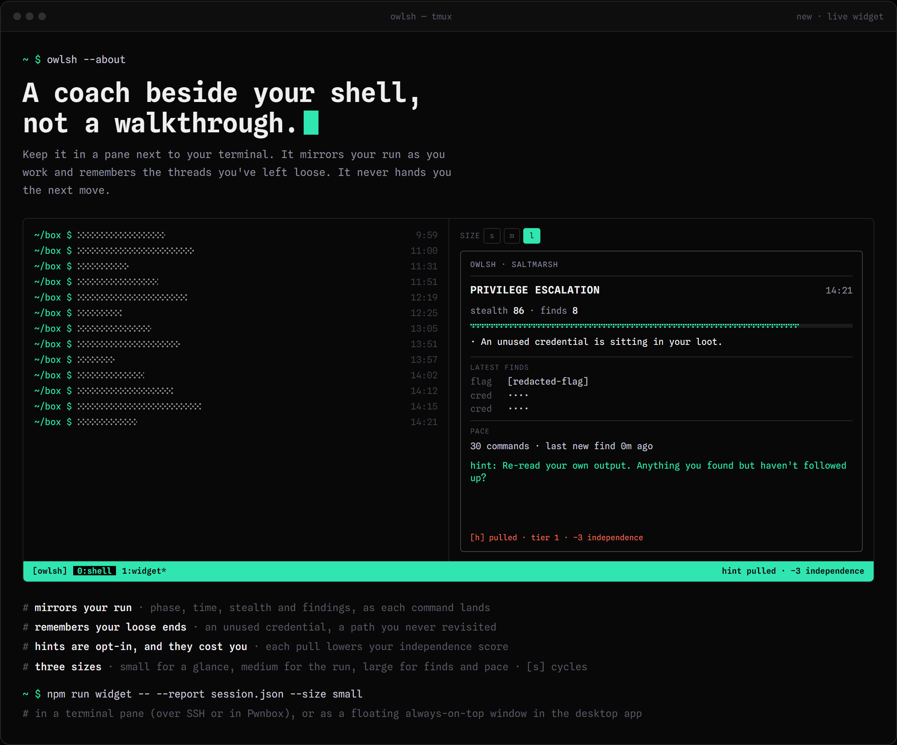

<div align="center">

<picture>
  <source media="(prefers-color-scheme: dark)" srcset="docs/brand/owlsh-dark.svg">
  
</picture>

# owlsh

**A local-first flight recorder for security practice.**

Record your run against any box, then get a graded debrief: what you achieved, where you lost time, and the one thing to fix next. It grades defenders too.

**[owlsh.com](https://owlsh.com)** · [Features](#features) · [How it works](#how-it-works) · [Install](#install) · [Usage](#usage) · [AI coaching](#ai-coaching) · [Testing](TESTING.md)

</div>

<p align="center">
  
</p>

<table>
  <tr>
    <td width="50%"><br><b>The verdict.</b> One grade for the whole run, with stealth scored alongside.</td>
    <td width="50%"><br><b>The one lesson.</b> The single highest-value fix, linked to the step where it happened.</td>
  </tr>
  <tr>
    <td width="50%"><br><b>A grade you can defend.</b> Seven weighted metrics across ATT&amp;CK, the Kill Chain and CWE.</td>
    <td width="50%"><br><b>The report, drafted for you.</b> An OSCP/CPTS-style write-up with a CISO summary, exported as Markdown or PDF. <a href="https://owlsh.com/assets/owlsh-sample-report-saltmarsh.pdf">Sample PDF</a>.</td>
  </tr>
  <tr>
    <td colspan="2"><br><b>A coach beside your shell.</b> The live widget mirrors your run in a tmux pane and flags loose ends. Hints are opt-in and cost you score.</td>
  </tr>
</table>

---

owlsh records the commands you run against a target on Hack The Box, TryHackMe, OffSec, Immersive Labs, or a local CTF, and turns the run into a graded debrief. Every run is read through three frameworks at once: **MITRE ATT&CK** for *what* you did, the **Unified Kill Chain** for the *order* (so backtracking is measurable), and **CWE** for the *weakness class* (so SQLi and XXE count as two skills). Everything runs on your machine. No account, no telemetry, no cloud.

## Features

- **Graded debrief, per phase.** A Lighthouse-style audit across ATT&CK, the Kill Chain and CWE, ending in an explainable letter grade.
- **The one lesson.** The single highest-value fix for next time, deep-linked to the exact step.
- **Live Ops.** Kill-chain position, stealth burn and a next-move nudge, streaming as you work.
- **The Ghost.** The best line through the box, drawn from your own findings: where you ran ahead, went off-path, or pivoted too late. With no write-up it still flags what your run proves you missed, like a credential you found but never used, or access you opened but never audited.
- **Any capture source.** A userspace PTY agent (no eBPF, ptrace or kernel hooks), plus import of a Claude Code transcript, a Burp/ZAP HAR, or a Sysmon/EDR log.
- **Grade defenders too.** Pair an attacker capture with an analyst's investigation and score the response.
- **Optional AI coaching.** Connect a model you already have for sharper hints, or stay fully offline on built-in rules. Hints are graded and cost score, and the model never sees the write-up. See [AI coaching](#ai-coaching).
- **Progress across runs.** Grade, coverage and methodology charted over your history.
- **Local-first.** Deterministic scoring. An optional model only sharpens the wording, never the numbers.

## How it works

Three steps, all on your machine:

1. **Record.** A small agent watches your shell through a normal terminal, no kernel hooks or special privileges. (Or import a Claude Code, Burp, or Sysmon capture instead.)
2. **Grade.** owlsh scores the run the same way every time, against MITRE ATT&CK, the Kill Chain and CWE, and compares it to the best line through the box.
3. **Coach.** The debrief shows your grade, the one fix that matters most, and where you went off-path. An optional AI model only sharpens the wording, never the numbers.

It all lands in one versioned JSON report ([schema](schema/owlsh-report.schema.json)) the app renders. Nothing leaves your machine unless you opt in (see [Privacy](#privacy)).

## Install

**Desktop app.** Grab the installer for your OS from the **[latest release](https://github.com/silofy/owlsh/releases/latest)** (`.dmg`, `.msi`/`.exe`, `.AppImage`/`.deb`/`.rpm`). Builds aren't signed yet: on macOS, right-click then **Open**; on Windows SmartScreen, choose **More info** then **Run anyway**. Each release lists `SHA256SUMS` so you can verify a download.

### Capture agent

One static binary (musl), no runtime deps, same on Kali, Parrot, and cloud boxes like HTB Pwnbox:

```sh
curl -fsSL https://raw.githubusercontent.com/silofy/owlsh/main/install.sh | sh   # macOS, Kali, Parrot, Pwnbox
irm  https://raw.githubusercontent.com/silofy/owlsh/main/install.ps1 | iex       # Windows
```

The installer verifies the binary against `SHA256SUMS` and drops it in `~/.local/bin`. Also shipped as a `.deb`, with a signed apt repo coming (see [`packaging/`](packaging/)).

**Just want to look around?** Skip the install and open the [live demos](#demos). To build from source, run `npm run doctor` then `npm run tauri dev` (needs Node 24+ and Rust, see [TESTING.md](TESTING.md)).

## Demos

Two scripted runs you can watch build live in your browser, no install. These are fictional practice boxes on an invented platform ("Breachyard"), not real machines, write-ups or artwork:

- **[Breachyard Saltmarsh](https://silofy.github.io/owlsh/?demo=saltmarsh)** (medium). Samba print-job RCE, then rclone creds, a wide-links pivot, and a writable systemd drop-in to root.
- **[Breachyard Dunmoor](https://silofy.github.io/owlsh/?demo=dunmoor)** (easy). Upload-filter bypass to a www-data shell, then a SUID-python GTFOBins jump to root.

## The debrief

When the run ends, the live panel settles into a single-column, lesson-first report: the verdict, then the one thing to fix, then the detail. You get "what do I do differently next time" before you scroll. [See it in the demo ▶](https://silofy.github.io/owlsh/?demo=saltmarsh)

## Usage

Record a run. It streams into the desktop app live; type `exit` to stop. When it ends you get the graded debrief. That's the whole loop.

```sh
owlsh --attach --platform htb --target <box>   # platform: htb | thm | offsec | immersive | local
```

**On a cloud box** (Pwnbox, OffSec Kali) with no local app? Capture to a file instead, then open it via **History → Import session** (or drag it in). The app can also pull it over SSH; the wizard walks you through it. Full guide: **[CAPTURE.md](crates/capture/CAPTURE.md)**.

```sh
owlsh --export run.json --platform htb --target <box>
```

**Grade from another source.** owlsh scores a run from any of these too, each tagged by source in the debrief. A run with no write-up is still graded against a canonical methodology ladder, so coverage is meaningful:

| Source | Command |
| --- | --- |
| Terminal (PTY) | `owlsh --attach --platform htb --target <box>` |
| Claude Code transcript | `npm run ingest:claude-code -- --transcript <session.jsonl>` |
| HTTP proxy (HAR) | `npm run ingest:http-proxy -- --har <capture.har>` |
| Sysmon / EDR | `npm run ingest:sysmon -- --events <sysmon.json>` |
| Defensive investigation | `npm run ingest:defense -- --incident <attacker capture> --run <analyst session>` |

The **defensive** run uses the attacker capture as the answer key and scores the analyst's investigation.

**Optional extras:**

- **Live widget.** A compact, always-on-top companion to park beside your shell. Click **Widget** in the app (or run `npm run widget`). It mirrors your run and flags loose threads; pull hints with `h`, each costs score.
- **Draft a report.** Turn a run into an OSCP/CPTS-style Markdown report: `npm run report`.
- **Web traffic.** Add `--web` to fold Burp HTTP attacks onto the timeline, redacted and in-scope only. [Setup](docs/web-capture.md).

## AI coaching

owlsh works fully offline on built-in rules. You can also connect a model for sharper, run-aware hints. Pick one in setup:

- **Rules (default).** Deterministic hints, fully offline, no setup.
- **Your Claude or Gemini plan.** Coach through a model you already pay for, over MCP. No API key, no extra cost.
- **An API key.** Claude, ChatGPT, Gemini, or OpenRouter.
- **A local model.** Run Ollama on your own machine, fully offline.

The header shows which model is connected. Whichever you pick, hints stay graded: you pull them with `h`, they escalate one tier at a time (how you're working, then where to look, then the class of technique), and each one costs score (3, 6, then 10 points). Taking none costs nothing.

owlsh sends the model your redacted session, never the write-up. If you link a write-up, the model is told only which objectives you have hit and which you have not, as abstract labels, not the write-up text. A fail-closed guard then strips anything concrete (IPs, paths, CVEs, credentials, or a step you have not reached), so a hint nudges your process without handing you the answer.

In plain terms: a hint is a friend who can see your moves but not the answer key. With no model it is a generic nudge; connect your own and it reacts to your actual run; add a write-up and it knows which step you are stuck on.

## Privacy

By default your session never leaves the machine, and redaction runs before anything hits disk. Two opt-in paths make outbound requests, each by your action: fetching a write-up you asked for, and sending a **cloud** coaching model your commands if you pick one over the local option (redacted first, with IPs, creds and flags stripped). Rules-based and local (Ollama) coaching stay fully offline. API keys and tokens are stored only on your machine. More in **[TESTING.md](TESTING.md)**.

## License

[AGPL-3.0](LICENSE). Use, study and modify owlsh freely. If you distribute a modified version, or run one as a network service, publish your changes under the same license.

**Commercial licensing.** The AGPL suits individuals, labs and open-source use. If you want to embed owlsh in a closed-source product, or offer it as a hosted service without AGPL's source-sharing obligations, a commercial license is available. Reach out via [owlsh.com](https://owlsh.com).

Contributions are welcome under a lightweight [Contributor License Agreement](CLA.md). See [CONTRIBUTING.md](CONTRIBUTING.md).
